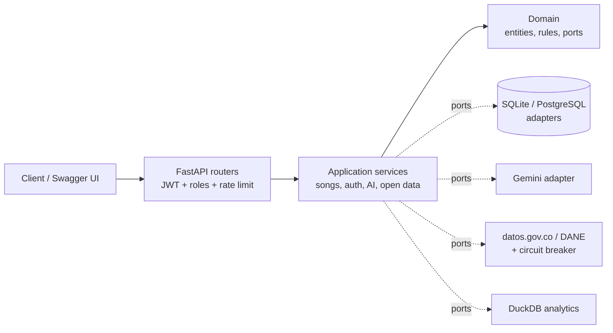
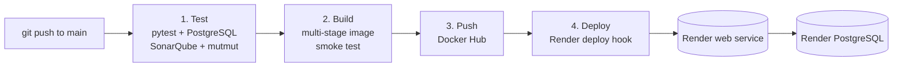

# Enlace Sonoro API

[](https://github.com/n-montenegro/enlace-sonoro-api/actions/workflows/ci.yml)
[](https://sonarcloud.io/summary/new_code?id=n-montenegro_enlace-sonoro-api)
[](https://sonarcloud.io/summary/new_code?id=n-montenegro_enlace-sonoro-api)

[](https://hub.docker.com/r/nmontenegro/enlace-sonoro-api)
[](https://enlace-sonoro-api.onrender.com/docs)

**Enlace Sonoro** is the REST API of a music player that we built during the *Taller de Programación* course
at Universidad Manuela Beltrán (Bogotá, Colombia). It started as a simple song catalog with a doubly linked
list for the playlist, and during the semester it grew into a small production system: an AI music assistant,
analytics over Colombian open data, JWT security, automated quality checks and a containerized deployment.

**Live demo:** https://enlace-sonoro-api.onrender.com/docs (free instance: the first request after a while
can take about one minute while the server wakes up).

Authors: **Nicolas Montenegro Gonzalez** and **Jhorman David Pardo Villamil**.

## Features

- **Song catalog (CRUD).** Create, list, update and delete songs. Everybody with an account can read the catalog;
  only administrators can change it.
- **AI music assistant.** `POST /api/v1/ai` uses retrieval-augmented generation (RAG): it looks for the songs of
  our catalog that match the question, builds a prompt with one of three techniques (zero-shot, few-shot or
  chain-of-thought) and asks Google Gemini for a recommendation. Every call is logged with tokens and latency.
- **Colombian open data.** The API reads the DIVIPOLA list of municipalities from datos.gov.co and the Cultural
  Consumption Survey from DANE, and analyzes them with DuckDB. A circuit breaker protects the API when those
  services fail, and the `/dashboard` page shows the results as charts.
- **Security.** JWT authentication with two roles (ADMIN and USER), passwords hashed with PBKDF2-SHA256
  (600,000 iterations), rate limiting, security headers and ten controls of the OWASP API Security Top 10 2023.

## Architecture

We used a **hexagonal architecture** (ports and adapters). The domain does not know about FastAPI, databases
or Gemini; it only defines ports (interfaces). The adapters live in `infrastructure/` and are connected in one
place, the composition root (`app/main.py`). Thanks to this, moving from SQLite to PostgreSQL for production
only needed two new adapters, and the business logic did not change.



### Deployment



The pipeline has four stages and each one only runs if the previous one is green. The deploy stage sends to
Render the exact image (by its `sha256` digest) that passed the tests, and then waits until `GET /health` on the
public URL answers with the new commit. Pull requests, for example the ones from Dependabot, stop after the
build stage, so nothing is deployed without being merged.

## Tech stack

Python 3.12 · FastAPI · Pydantic · SQLite and PostgreSQL (psycopg 3) · DuckDB · Google Gemini · PyJWT ·
pytest + pytest-cov · mutmut · Docker + docker-compose · GitHub Actions · SonarQube Cloud · CodeQL · Dependabot ·
Docker Hub · Render.

## Run it

### With Docker (API + PostgreSQL)

```bash
cp .env.example .env          # then write your own keys and passwords in .env
docker compose up --build -d
docker compose ps             # both services should be "healthy"
```

Open http://localhost:8000/docs. The first ADMIN user is created from `ADMIN_USERNAME` and `ADMIN_PASSWORD`.

### Without Docker (SQLite)

```bash
python -m venv venv
venv\Scripts\activate          # Windows  (Linux/Mac: source venv/bin/activate)
pip install -r requirements.txt
python -m uvicorn app.main:app --reload
```

## Tests and quality

```bash
python -m pytest -v            # 139 tests; the PostgreSQL ones run in CI
python -m pytest --cov=app     # with coverage
```

- **SonarQube Cloud** analyzes every push with test coverage; the Quality Gate must pass.
  See the [issues we fixed](docs/quality/sonarcloud.md).
- **Mutation testing** with mutmut runs in GitHub Actions and the build fails if the score is below 50 %.
  Our score is 99.8 % (431 of 432 mutants killed). See the [mutant analysis](docs/quality/mutation-testing.md).
- **Supply chain:** dependencies are installed from lock files with SHA-256 hashes, GitHub Actions are pinned
  to a full commit SHA, and CodeQL and Dependabot watch the code and the dependencies.

## The Docker image

The `Dockerfile` uses a multi-stage build on `python:3.12-slim`, installs only the production dependencies
(`requirements-prod.txt`), runs as a non-root user and has a health check. Compared with a typical single-stage
image based on `python:3.12`, the size went from 1.86 GB to 337 MB on disk (from 496 MB to 83.6 MB compressed),
about 82 % smaller. More details in [docs/deploy/despliegue.md](docs/deploy/despliegue.md).

## Main endpoints

| Method | Path | Access |
|---|---|---|
| POST | /api/v1/auth/register | Public (always creates a USER) |
| POST | /api/v1/auth/login | Public (returns a JWT) |
| GET | /api/v1/songs | USER or ADMIN |
| POST, PUT, DELETE | /api/v1/songs | ADMIN |
| POST | /api/v1/ai | USER or ADMIN |
| GET | /api/v1/opendata/municipalities/stats | Public |
| GET | /api/v1/admin/stats | ADMIN |
| GET | /health | Public (API + database) |

## Documentation

- [ADR 0001 – Hexagonal architecture](docs/adr/0001-hexagonal-architecture.md) and [bounded contexts](docs/bounded-contexts.md)
- [OWASP API Security Top 10 2023 controls](docs/security/owasp-api-top10-2023.md)
- [Prompting comparison](docs/prompting_comparison.md) and [cost estimate](docs/cost_estimate.md)
- [Production deployment](docs/deploy/despliegue.md)

## What we learned

This project taught us that working software is only the first step. Tests that look good can still miss bugs
(mutation testing showed us that), security has to be designed from the beginning, and a deployment is reliable
only when it is automatic and repeatable. We also learned to use AI assistants like GitHub Copilot critically:
their suggestions helped us, but we always reviewed and tested them before using them.
