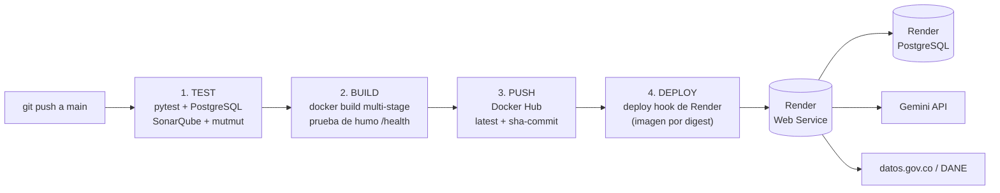

# Despliegue en producción (Guía 8)

## Arquitectura de despliegue



- La etapa 4 despliega **la misma imagen** (identificada por su digest `sha256`) que pasó las pruebas,
  y espera hasta que `GET /health` de la URL pública responda con la versión (commit) nueva.
- PUSH y DEPLOY solo corren en `main`; en pull requests (por ejemplo los de Dependabot) llegan hasta BUILD.

## ¿Por qué PostgreSQL en producción?

El disco de un servicio gratuito de Render (y de cualquier contenedor) se borra en cada despliegue o reinicio.
Con SQLite se perderían las canciones y los usuarios. Por la arquitectura hexagonal bastó con agregar dos
adaptadores (`PostgresSongRepository`, `PostgresUserRepository`); el dominio y los servicios no cambiaron.
`main.py` escoge PostgreSQL si existe `DATABASE_URL` y SQLite si no (desarrollo y pruebas).

## Dockerfile optimizado

| Práctica | Cómo se aplicó |
|---|---|
| Multi-stage build | Etapa `builder` instala dependencias en `/opt/venv`; la etapa final copia solo ese entorno y `app/` |
| Imagen base pequeña | `python:3.12-slim` en las dos etapas |
| Solo dependencias de producción | `requirements-prod.txt` (sin pytest, pytest-cov ni mutmut), mismas versiones del CI y con hash |
| Usuario no-root | `appuser` (UID 10001); el código es de root y la app no puede modificarlo |
| `.dockerignore` | Excluye `.env`, `*.db`, `venv/`, `.git/`, pruebas y documentación |
| Health check | `HEALTHCHECK` llama a `/health`, que también verifica la base de datos |

## Comparativa de tamaño de la imagen (antes / después)

"Antes" es un Dockerfile típico de una sola etapa (el que suele sugerir un tutorial o un asistente de IA):

```dockerfile
FROM python:3.12
WORKDIR /app
COPY . .
RUN pip install -r requirements.txt
CMD ["uvicorn", "app.main:app", "--host", "0.0.0.0"]
```

Medición en nuestro equipo con `docker image ls`:

| Imagen | Base | Etapas | Usuario | Tamaño |
|---|---|---|---|---|
| Antes (`enlace-sonoro-api:naive`) | `python:3.12` | 1 | root | _medir_ |
| Después (`enlace-sonoro-api:local`) | `python:3.12-slim` | 2 | appuser | _medir_ |

## Variables de entorno en Render

| Variable | Valor |
|---|---|
| `DATABASE_URL` | *Internal Database URL* de la base de datos PostgreSQL de Render |
| `JWT_SECRET` | 48+ caracteres aleatorios (`python -c "import secrets; print(secrets.token_urlsafe(48))"`) |
| `GEMINI_API_KEY` | clave de Google AI Studio |
| `ADMIN_USERNAME` / `ADMIN_PASSWORD` | primer administrador (solo se crea si no hay usuarios) |
| `CORS_ORIGINS` | la URL pública, por ejemplo `https://enlace-sonoro-api.onrender.com` |
| `FORWARDED_ALLOW_IPS` | `*` (Render es el proxy: así el rate limiting ve la IP real del cliente) |

## Limitaciones del plan gratuito de Render

- El servicio se apaga después de 15 minutos sin tráfico; la primera petición tarda cerca de un minuto en despertarlo.
- La base de datos PostgreSQL gratuita tiene 1 GB y vence 30 días después de creada.
- Los archivos que escribe la app (`logs/`, `data/`) se pierden en cada despliegue; los datos importantes están en PostgreSQL.
